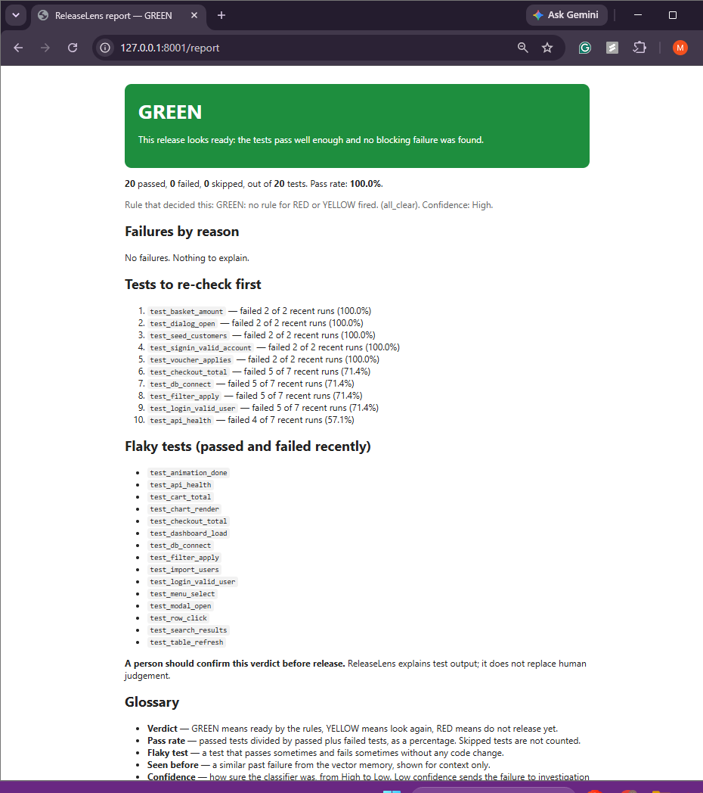
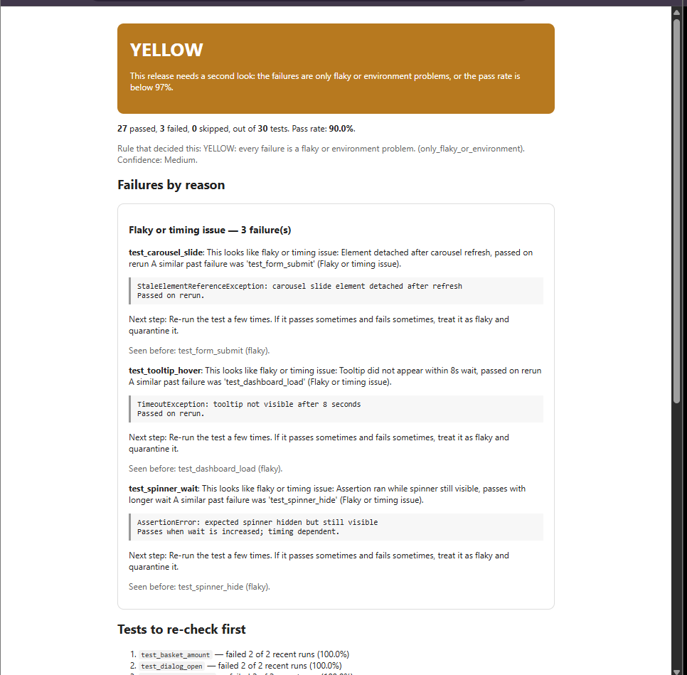
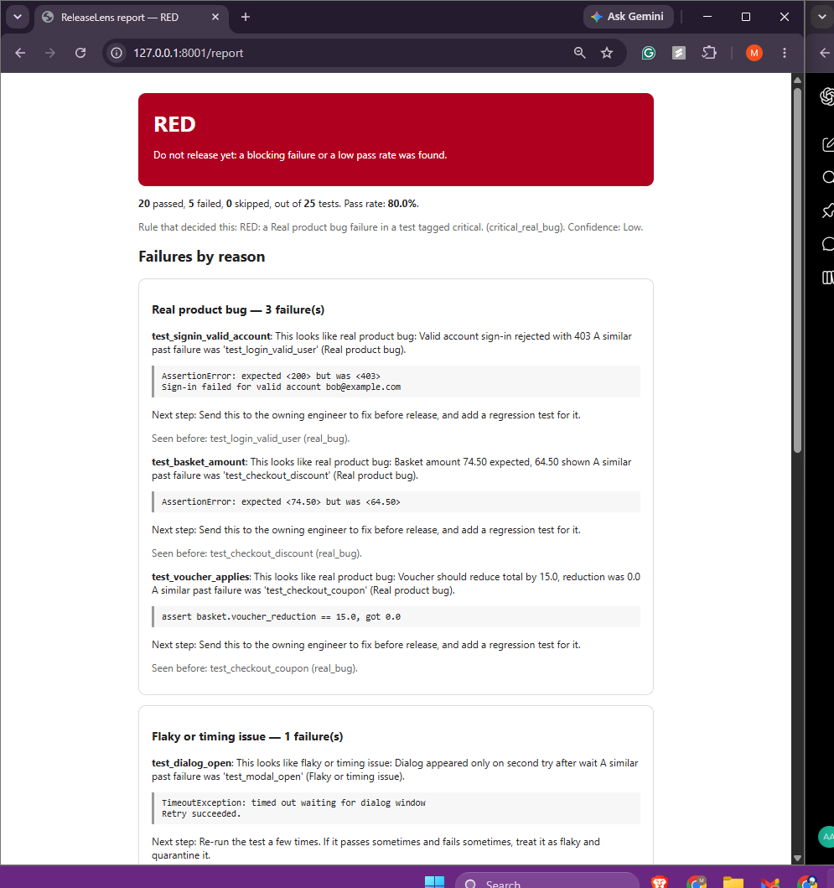
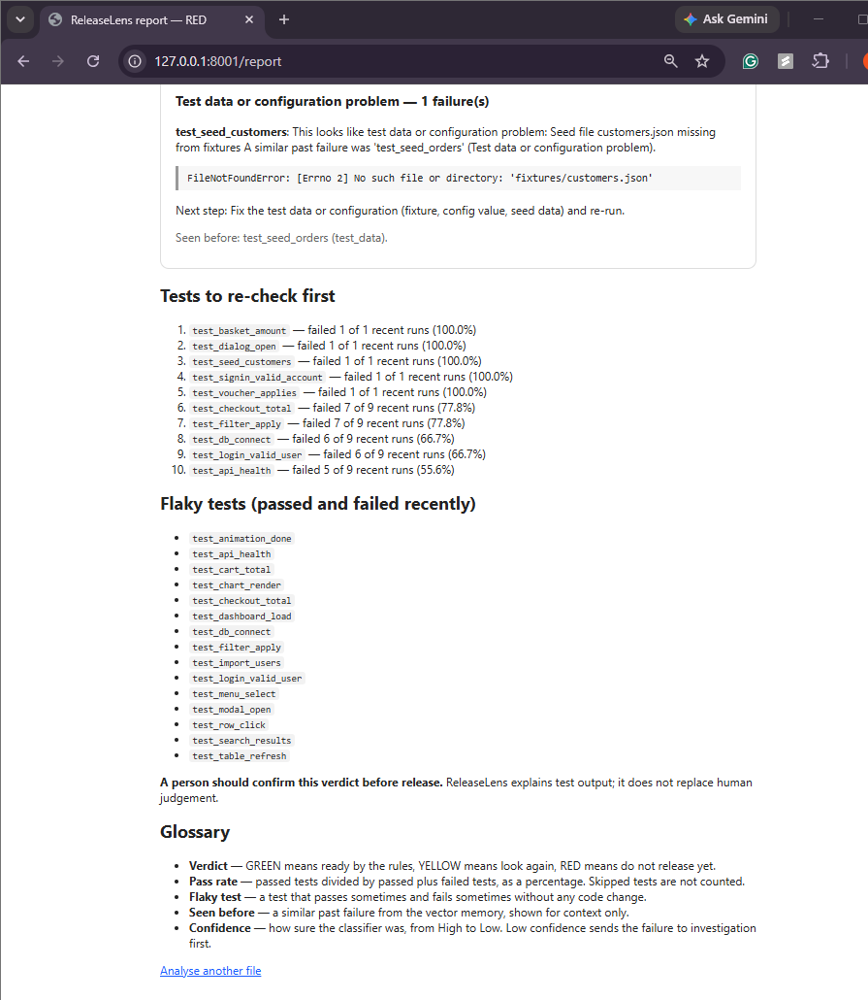
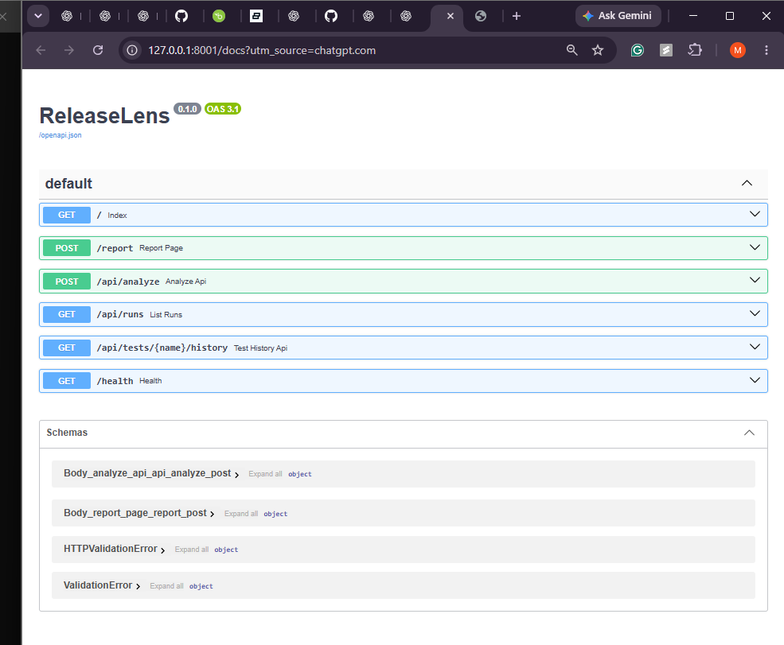
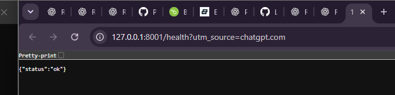
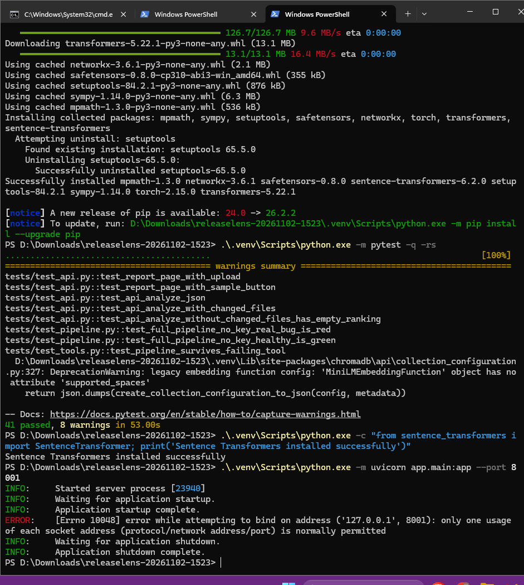

# ReleaseLens — can we release? A plain-English report from test results

Managers and product owners must decide "can we release?" from raw test
output they cannot read, and engineers waste time sorting failures into
real bug vs server problem vs flaky test. ReleaseLens takes a JUnit XML
file and returns a one-page report: a **GREEN / YELLOW / RED** verdict,
failures grouped by plain-English reason with evidence from the log, a
"seen before" reference to similar past failures, and a list of tests
to re-check first. It is **not a chatbot**: there is no chat UI anywhere.

## Who uses it

- **Managers / product owners** read the verdict banner, the one-sentence
  "what this means", and the grouped reasons. No log reading required.
- **Engineers** use the evidence lines, the next step per failure, the
  "seen before" reference, and the re-check list to decide what to fix
  or re-run first.

## Design principle: the LLM only EXPLAINS

A deterministic rules file (`rules.yaml`) decides GREEN / YELLOW / RED.
The LLM never decides the verdict — it only writes explanations, and a
verify guard checks its output (category must be one of the 5 fixed
values; every evidence line must appear verbatim in the log). This is
easy to explain to non-technical users and limits hallucination risk.

## 3-step usage

1. Upload a JUnit XML file on the home page — or press **Try with a
   sample** (no file needed).
2. Read the one-page report: verdict, grouped failures with evidence
   and next steps, tests to re-check first.
3. A person confirms the verdict before release (the page says so).

## Run it (under 5 commands)

```bash
python3 -m venv .venv && source .venv/bin/activate
pip install -r requirements.txt
python scripts/seed_db.py        # optional: the app seeds on first use too
uvicorn app.main:app --port 8000
# open http://localhost:8000
```

Optional LLM explanations: copy `.env.example` to `.env` and set
`LLM_API_KEY` (plus `LLM_BASE_URL` / `LLM_MODEL` for an OpenAI-compatible
endpoint). With no key, the app works fully in no-key mode: the explain
node uses a deterministic template instead of the LLM.

Docker (not run in this VM — see RESULTS.md for the exact blocker:
the daemon runs but cannot pull images through this environment's
egress proxy, and `docker compose` is unavailable here):

```bash
docker compose up --build   # serves http://localhost:8000 (untested here)
```

## Screenshots — verified Windows demo (2 November 2026)

These are **actual screenshots from the local ReleaseLens demonstration** on Windows 11, not generated mockups. The example JUnit data and historical runs are **synthetic**. Verdicts apply to the supplied sample runs only and do not certify any real release. The screenshots show the local FastAPI app running on port 8001; use your own available port when running it.

### 1. GREEN — release appears ready



**What is shown:** 20 passed / 0 failed, 100% pass rate, GREEN verdict (`all_clear`). No current-run failures are reported. The re-check list below still shows risk from **previous runs**, which is not a contradiction: the verdict concerns the uploaded run, while the ranking uses run history.

### 2. YELLOW — flaky tests need review



**What is shown:** 27 passed / 3 failed, 90% pass rate, YELLOW verdict (`only_flaky_or_environment`). Three timing or flakiness-related failures are grouped together, with verbatim log evidence, suggested re-runs, and similar past tests. This outcome calls for a human review, not automatic approval.

### 3. RED — critical product bug blocks release



**What is shown:** 20 passed / 5 failed, 80% pass rate, RED verdict (`critical_real_bug`). Failures include a sign-in 403 error, basket amount mismatch, and a voucher defect, with accompanying log evidence and nearest similar historical failures. The low pass rate is another reason to block the sample release.

### 4. RED report — historical risk and test selection



**What is shown:** the ranked **tests to re-check first**, recent failure counts and percentages, history-based flaky-test list, explicit human-confirmation notice, and a glossary for non-technical readers. The ranking relies on stored synthetic history; it is not a forecast validated on production data.

### 5. FastAPI REST API documentation



**What is shown:** `/`, `/report`, `/api/analyze`, `/api/runs`, `/api/tests/{name}/history`, and `/health` in the automatically generated Swagger/OpenAPI interface.

### 6. Health-check endpoint



**What is shown:** local GET `/health` returns `{"status":"ok"}`.

### 7. Windows automated-test evidence



**What is shown:** after installing `sentence-transformers`, the Windows environment completed **41 tests passed, 0 failed, 0 skipped, 8 ChromaDB deprecation warnings in 53.00 seconds**. The same screenshot includes a later port 8001 collision, which happened because an earlier server was already listening; the app was then run on port 8002. These are test-suite counts, not classification accuracy or LLM evaluation results.

### Run on Windows PowerShell

```powershell
cd "D:\Downloads\releaselens-20261102-1523"
python -m venv .venv
.\.venv\Scripts\python.exe -m pip install -r requirements.txt
.\.venv\Scripts\python.exe -m pip install sentence-transformers
.\.venv\Scripts\python.exe -m pytest -q
.\.venv\Scripts\python.exe -m uvicorn app.main:app --host 127.0.0.1 --port 8002
```

The `sentence-transformers` dependency may download PyTorch and model weights. If port 8002 is busy, use another free port. No LLM API key is needed for the deterministic explanation mode.

## Architecture (LangGraph flow)

```mermaid
flowchart LR
    A[parse\nJUnit XML] --> B[classify\nword+char TF-IDF + LogReg]
    B -->|confidence >= 0.75| D[explain]
    B -->|confidence < 0.75| C[investigate\nmax 3 tool calls]
    C --> D[explain\ntemplate or LLM]
    D --> E[verify\nenum + verbatim evidence]
    E --> F[decide\nrules.yaml]
    F --> G[render\nreport page + SQLite]
    H[changed files\n(optional)] --> I[tests to run first\nfixed heuristic, no LLM]
    G -.-> I
```

- **parse** (`app/parser.py`): JUnit XML -> test results and failures
  (name, message, log text, critical property).
- **classify** (`app/classifier.py`): word n-grams (1-2) + character
  n-grams (char_wb 3-5) TF-IDF + LogisticRegression over the labeled
  data; returns category + confidence per failure. The character
  features were added after the error analysis (see RESULTS.md).
- **tests to run first** (`app/selection.py`, wired in `app/main.py`):
  when changed file paths are submitted with the upload, tests are
  ranked by name overlap with those files, recent failure rate from
  SQL, and flaky status. Fixed weights, no LLM. Shown on the report
  page and in `/api/analyze` JSON.
- **vector memory** (`app/embeddings.py`, `app/memory.py`): ChromaDB
  "seen before" references. The active embedding is all-MiniLM-L6-v2
  (sentence-transformers, model cached per process); TF-IDF is the
  documented fallback when MiniLM cannot load. On this synthetic
  data MiniLM measures worse than TF-IDF for retrieval (see
  RESULTS.md); the memory affects only the "seen before" context,
  never the verdict.
- **route**: conditional edge on the lowest confidence (0.75 threshold).
- **investigate** (`app/agent/tools.py`): LangChain tools
  `search_similar_failures`, `get_test_history`, `get_log_excerpt`.
  At most 3 calls; tool errors are returned as text, never raised. With
  a key, a small ReAct loop picks the tools; without one, the tools run
  directly in order.
- **explain**: Pydantic structured output (`category`, `plain_english_reason`,
  `evidence_lines`, `suggested_next_step`). No key -> deterministic
  template from the classifier result + nearest past failure.
- **verify** (`app/agent/graph.py`): invalid category falls back to the
  classifier's category; non-verbatim evidence lines are dropped and
  counted as unverified.
- **decide** (`app/rules.py` + `rules.yaml`): RED if a critical test has
  a Real-product-bug failure or pass rate < 90%; YELLOW if only
  flaky/environment failures or pass rate 90–97%; otherwise GREEN. The
  report shows which rule fired.
- **render**: report page + JSON API, and the run is saved to SQLite
  (`runs`, `test_results`, `failures`).

## Endpoints

| Method | Path | What it does |
|---|---|---|
| GET | `/` | Upload page (with "Try with a sample") |
| POST | `/report` | HTML report (file upload or `sample` form field) |
| POST | `/api/analyze` | JSON report (same inputs) |
| GET | `/api/runs` | Recent runs |
| GET | `/api/tests/{name}/history` | History for one test |
| GET | `/health` | `{"status": "ok"}` |

## Data (all synthetic — disclosed)

- `data/failures_labeled.csv`: 180 rows — 150 template failures (30 per
  category: 6 families x 5 variants) plus 30 hand-written hard cases.
  Every row has a `template_family` id, used for GroupKFold evaluation.
- `data/samples/`: 4 JUnit XML files — `healthy` (GREEN), `flaky_heavy`
  (YELLOW), `server_outage` (RED), `real_bug` (RED).
- 20 historical runs are seeded into SQLite (see `app/seed.py`) so the
  flaky query and re-check ranking have history to work with.

## Embeddings: MiniLM active, TF-IDF fallback

The design prefers sentence-transformers all-MiniLM-L6-v2 for ChromaDB,
and that is what now runs: sentence-transformers 6.2.0 + torch
2.15.0 were installed into the project venv with `TMPDIR` on the home
disk (the small /tmp broke the first attempt; the PyTorch CPU index
timed out through the proxy, so the standard PyPI build is used on
CPU). The code tries MiniLM first on every start
(`app/embeddings.py:get_embedding_function`) and falls back to a
scikit-learn TF-IDF embedding function fitted on the labeled data if
MiniLM cannot load; the collection name includes the embedding name,
so the two choices never share a collection. The MiniLM model is
cached per process (a reload on every pipeline run raised the average
report time to 2.614s; with the cache it is 1.759s — see RESULTS.md).
Honest caveat, measured on this synthetic data: MiniLM scores lower
than TF-IDF for retrieval (B: 0.6722 vs 0.7556 accuracy), so on this
dataset TF-IDF would be the better retrieval choice; MiniLM stays
active because it is the required embedding, and the memory affects
only "seen before" context, never the verdict.

## Research basis and limits

Cited sources ONLY (no other papers, no invented statistics):

1. **Chen et al., "Automatic Root Cause Analysis via Large Language
   Models for Cloud Incidents" (RCACopilot), EuroSys 2024, arXiv
   2305.15778.** What it does: retrieves similar historical incidents,
   predicts a root-cause category, and gives an explanatory narrative.
   How ReleaseLens applies it at student scale: ChromaDB retrieves
   similar past failures, the classifier predicts one of 5 fixed
   categories, and the explain node writes a plain-English narrative
   with evidence. The "incidents" here are synthetic test failures,
   not cloud incidents.
2. **Roy et al., "Exploring LLM-based Agents for Root Cause Analysis",
   FSE 2024 industry track, arXiv 2403.04123.** What it does: studies
   ReAct-style agents with retrieval tools for root-cause analysis,
   including practical needs such as tool-error handling and human
   intervention. How ReleaseLens applies it at student scale: the
   LangGraph investigate node is a small ReAct loop over three
   retrieval tools with a 3-call cap and tool errors returned as text,
   and the report requires a person to confirm before release.

What this project does NOT claim: no novelty (it combines the two
ideas above at small scale), no production validation (all data is
synthetic, the LLM paths were not evaluated without a key), and no
generalisability beyond the synthetic set. See RESULTS.md and
LIMITATIONS.md.

## Assumptions (reasonable, made autonomously)

1. JUnit XML follows the usual `<testsuites>/<testsuite>/<testcase>`
   shape, with `<failure>` / `<error>` / `<skipped>` children.
2. Pass rate = passed / (passed + failed) x 100; skipped tests are
   excluded from the rate.
3. A test is "critical" if its testcase carries
   `<property name="critical" value="true"/>` or its name contains a
   keyword from `rules.yaml` (login, payment, checkout, auth).
4. Routing is per-run on the lowest failure confidence (threshold
   0.75); a run with no failures goes straight to explain.
5. "Last 10 runs" for flaky / re-check queries means the 10 most recent
   run ids, including the run just analysed.
6. The report's "seen before" reference is the single nearest past
   failure from ChromaDB (context only, not a diagnosis).
7. `PROMPT_VERSION` defaults to `v2`; see PROMPTS.md for the v1 vs v2
   change.

## Project layout

```
app/            FastAPI app (main), parser, classifier, memory, rules, db
app/agent/      LangGraph graph, state, LangChain tools
app/templates/  upload page + report page (Jinja2, no chat UI)
data/           failures_labeled.csv + 4 sample JUnit files
prompts/        v1 + v2 explain prompts
scripts/        generate_data.py, make_samples.py, seed_db.py,
                evaluate.py, measure_reports.py
tests/          pytest suite (parser, classifier, verify, rules, SQL,
                tools, API, full no-key pipeline)
rules.yaml      deterministic release rules (editable)
```

## Results

See RESULTS.md for the real numbers (GroupKFold accuracy / macro-F1 /
confusion matrices, grounding rate, decision check, timing, test
count) and the exact commands to reproduce them.
